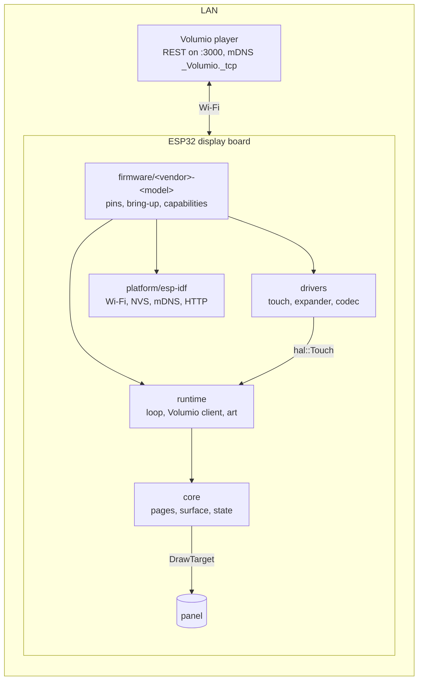
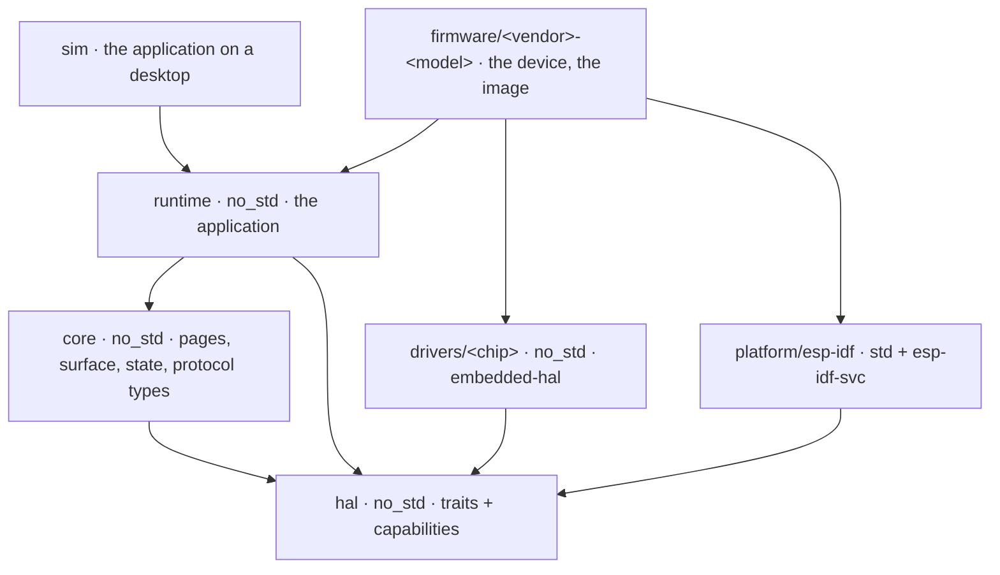

# Volumio ESP Companion

Now playing, transport, volume and album art on an ESP32 touch panel, talking to a Volumio player over the network. Firmware written in Rust for the family of ESP32 display boards: the pages, the player state and the Volumio client are written once and know nothing of the board; a board contributes its pins, its bring-up and a record of what it has, and a controller chip has one driver however many vendors solder it down.

It grows out of [rpi-waveshare28](https://github.com/foonerd/rpi-waveshare28), the Raspberry Pi runtime for the Waveshare 2.8" SPI LCD. Peter of [PIXIS](https://github.com/PIXISREPO/VOLUMIO-4-TOUCH), who tested that runtime on the PIXIS CB-1, asked for the same on the Waveshare ESP32-C5-Touch-LCD-2.8 and sent the first board to start tinkering with ([the Pi thread](https://community.volumio.com/t/re-re-pi-3a-volumio-waveshare-2-8-spi-lcd-display-is-working-cst328-touch-still-wip-help-appreciated/77681), [the ESP32 thread](https://community.volumio.com/t/re-2-8inch-esp32-waveshare-panel/77872)). Thank you, Peter.

**Where the project stands.** Pre-alpha. The toolchain is proven for the ESP32-C5: the firmware for the Waveshare ESP32-C5-Touch-LCD-2.8 builds std Rust on ESP-IDF and reports the chip, the PSRAM, a dual-band Wi-Fi scan and a connection. Nothing draws on a panel yet. The [wiki](https://github.com/foonerd/volumio-esp-companion/wiki) has the [connections](https://github.com/foonerd/volumio-esp-companion/wiki/Connections), the [boards](https://github.com/foonerd/volumio-esp-companion/wiki/Boards) and the [build](https://github.com/foonerd/volumio-esp-companion/wiki/Building).

<p align="center"></p>

The panel is a client of the player over the LAN, as the Volumio apps are: it finds the player by mDNS, polls its state over REST, sends transport and volume, fetches the art. Nothing is installed on the player.

## Boards

| Board | SoC | PSRAM | Flash | Display | Touch | Standing |
| --- | --- | --- | --- | --- | --- | --- |
| Waveshare ESP32-C5-Touch-LCD-2.8 | ESP32-C5, RISC-V, 2.4 and 5 GHz | 8 MB | 32 MB | ST7789, SPI, 240x320 | CST3530 | Firmware boots and reports; the board is on the bench. |
| Waveshare ESP32-C6-Touch-LCD-2.8 | ESP32-C6, RISC-V, 2.4 GHz | none | 16 MB | ST7789, SPI, 240x320 | CST3530 | Planned. |
| Waveshare ESP32-S3-Touch-LCD-2.8 | ESP32-S3, Xtensa | 8 MB | 16 MB | ST7789, SPI, 240x320 | CST3530 | Planned. |

The three Waveshare siblings come first; any vendor's ESP32 display board is in scope after them, SPI panels before QSPI, RGB and MIPI. The [Boards](https://github.com/foonerd/volumio-esp-companion/wiki/Boards) page carries the detail.

## What is in the box



| Layer | Where | Holds | Builds on |
| --- | --- | --- | --- |
| core | `core/` | The pages, the drawing surface, the player state model and the Volumio protocol types. `no_std`, no `unsafe`, no platform crate. | host and device |
| hal | `hal/` | The traits the core and the runtime talk to (touch source, network transport, configuration store) and the capabilities record a firmware fills in: resolution, PSRAM, microphone, speaker, IMU, Wi-Fi bands. The display is embedded-graphics' `DrawTarget`. | host and device |
| drivers | `drivers/<chip>/` | One crate per controller chip, over embedded-hal, vendor-neutral. SPI panels through mipidsi. | host and device |
| runtime | `runtime/` | The application: the loop as a state machine the device steps, the gesture derivation, the Volumio client, the album-art gate, the settings. `no_std`, generic over `hal`; the device owns threads, clock and I/O and calls in. | host and device |
| platform | `platform/esp-idf/` | What every ESP board shares, over esp-idf-svc: the HTTP client with mbedTLS and the certificate bundle, the settings store in NVS, the Wi-Fi as the network status. Built inside a firmware crate's workspace; no `unsafe`. | device |
| firmware | `firmware/<vendor>-<model>/` | The device. One crate per board, a workspace of its own with its target, toolchain, sdkconfig and partition table; the pin map, the bring-up, the expanders, the capabilities record; a thin `main.rs` that builds the board and hands it to the runtime. Its build is the image you flash. | that device |
| sim | `sim/` | The application on a desktop window or in a PNG, talking to a real player, for page work without a board. The host's HTTP, interfaces and a thread for art stand in for the device. | host |

Today: `hal/` holds the traits and the capabilities record; `core/` holds the pages, the surfaces and the player state model; `runtime/` holds the application, carried over from rpi-waveshare28 with its rules intact and reshaped so a device steps it; `drivers/` holds the CH32V003 IO expander and the CST3530 touch controller; all of it with its tests, building for bare-metal RISC-V; `sim/` runs the application on a desktop against a real player; `platform/esp-idf/` gives an ESP board its HTTP, its settings store and its network status; `firmware/waveshare-esp32-c5-touch-lcd-28/` brings its board up through the expander, lights the panel and runs the application on it, touch and all. None of it has met the board yet; that is the bench's turn. Next after the bench: album art on the device, then audio.



Arrows read "depends on". Nothing above `runtime` knows ESP-IDF; nothing in `core`, `hal` or `runtime` knows std. The layers are the point. A new board is one crate under `firmware/`: its pins, its bring-up order and a filled-in capabilities record, and every page, the touch handling and the Volumio client come with it. A new controller chip is one crate under `drivers/`, written once against embedded-hal, and every board that carries the chip uses it. Nothing in `core/` knows a vendor's name.

## Build

The host workspace (`core`, `hal`, `runtime`, `sim`, the drivers) builds on stable Rust, pinned by `rust-toolchain.toml`. Each firmware crate pins its own channel: ESP-IDF std targets need nightly with `rust-src`, plus `ldproxy` and python3 with esptool 5; the first build fetches ESP-IDF and the chip's toolchain.

```sh
scripts/check.sh                                            # format, clippy, tests, docs, no_std on bare metal, scripts, then every firmware built
(cd firmware/waveshare-esp32-c5-touch-lcd-28 && cargo build --release)
scripts/image.sh firmware/waveshare-esp32-c5-touch-lcd-28   # the merged image and its parts into dist/
```

The simulator runs the application against a player on the network, in a window (needs `libsdl2-dev`) or straight to a PNG (needs nothing):

```sh
cargo run -p companion-sim -- --player http://volumio.local:3000 --rotation 90 --theme night
cargo run -p companion-sim --no-default-features -- --player http://volumio.local:3000 --snapshot face.png --after 5
```

The mouse is the finger; Escape quits. `--help` lists the settings it takes, which are the same keys a device reads from its store.

`check.sh` refuses to pass on a machine without the ESP toolchain rather than report a pass that never built the product. Without the toolchain on the machine, the builder image of `scripts/builder/Dockerfile` has everything; the first build fetches ESP-IDF into the firmware crate's `.embuild/`, which the mounted checkout keeps. The checkout is mounted at its own path because ESP-IDF's build records absolute paths under `target/`, and a tree built under one path will not rebuild under another:

```sh
docker build -t companion-builder -f scripts/builder/Dockerfile .
docker run --rm --user "$(id -u):$(id -g)" -e HOME=/tmp -v "$PWD:$PWD" -w "$PWD" companion-builder scripts/check.sh
docker run --rm --user "$(id -u):$(id -g)" -e HOME=/tmp -v "$PWD:$PWD" -w "$PWD" companion-builder scripts/image.sh firmware/waveshare-esp32-c5-touch-lcd-28
```

Each firmware crate's README has its flash command.

## License

MIT. The pages, the surface and the state model descend from [rpi-waveshare28](https://github.com/foonerd/rpi-waveshare28) by the same author. The register maps and bring-up sequences of the CH32V003 expander and the CST3530 touch controller are transcribed from Waveshare's board repository, [ESP32-C5-Touch-LCD-2.8](https://github.com/waveshareteam/ESP32-C5-Touch-LCD-2.8), Apache-2.0, copyright Waveshare and Espressif Systems; each driver's source names the file it was read from.
